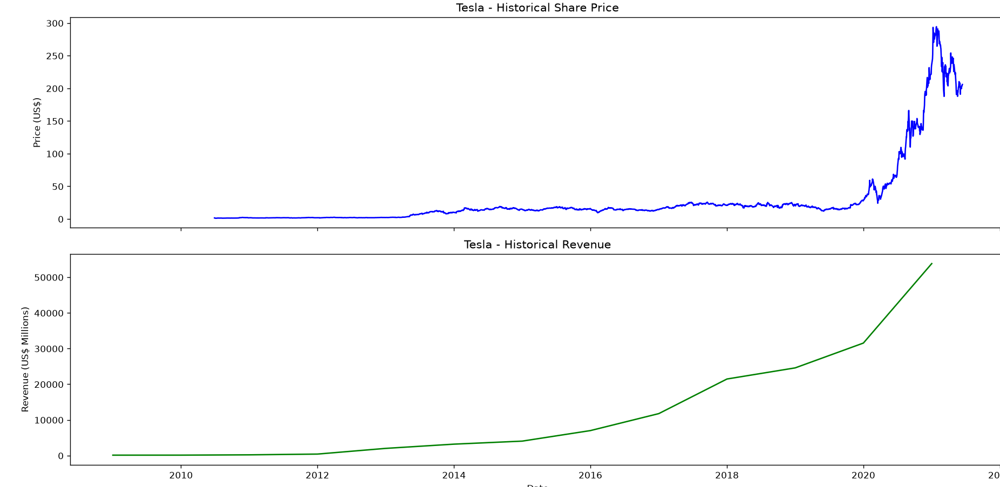

# Tesla Stock Price vs Revenue Analysis

Comparing Tesla's share price with its quarterly revenue, using data from Yahoo Finance and a web page, in Python.

## About

- **Goal:** See how Tesla's share price moved compared with its revenue over time.
- **Data:** Share price from Yahoo Finance (`yfinance`) and quarterly revenue scraped from an IBM Data Analyst Professional Certificate lab page.
- **Tools:** Python, pandas, yfinance, BeautifulSoup, Matplotlib, Seaborn

## What I Did

1. Downloaded Tesla's full share price history with `yfinance`.
2. Scraped Tesla's quarterly revenue table from a web page using `requests` and `BeautifulSoup`.
3. Cleaned the revenue data: removed `$` and `,` signs and converted dates and revenue to the right types.
4. Cut both datasets to the same time period (the revenue data ends in 2021).
5. Compared price and revenue quarter by quarter, using the average share price of each quarter.

## Charts

**1. Share Price and Revenue Over Time**
Revenue grew steadily while the share price rose sharply in 2020.



**2. Revenue vs Average Share Price**
Each dot is one quarter. Quarters with higher revenue also had higher average prices.


## Results

- **Quarters compared:** [number printed by the script]
- **Correlation between average price and revenue:** [value printed by the script]

A value close to 1 means price and revenue rose together. It does not prove that one caused the other.

## Limitations

- The revenue data ends in 2021, so the analysis stops there.
- Share price depends on many things besides revenue, such as news and market mood.
- Correlation shows that two things move together, not that one causes the other.

## How to Run

```bash
pip install -r requirements.txt
python tesla_stock_vs_revenue_analysis.py
```

Charts are saved in the `images/` folder. The share price data is downloaded live, so it needs an internet connection.

## Credits

Based on a lab from the **IBM Data Analyst Professional Certificate** on Coursera. I added the quarter-by-quarter comparison, the correlation and saved charts.
